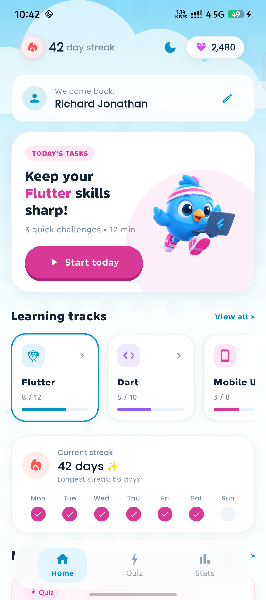
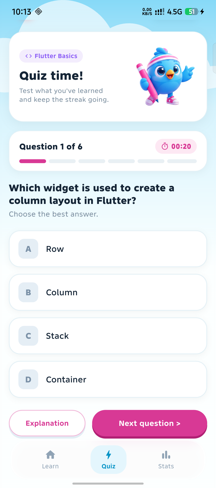
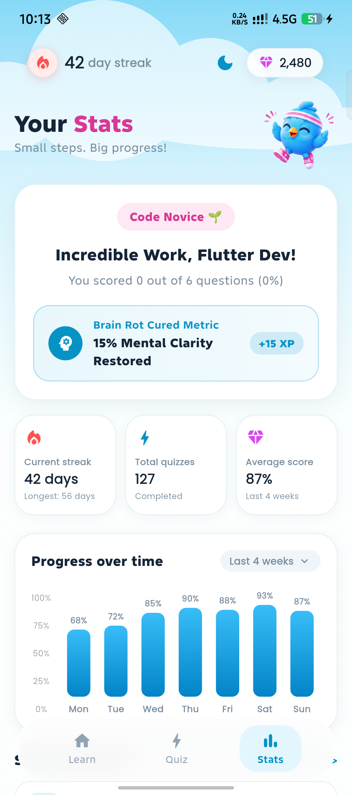

# FixRotting

Platform pembelajaran Ilmu Komputer berbasis Flutter yang mengusung konsep kuis interaktif ala Duolingo. Dirancang untuk mengasah fondasi _software engineering_ melalui modul teknis yang cepat dan menyenangkan

---

## 📋 A. Identitas Mahasiswa

| Kategori           | Keterangan         |
| :----------------- | :----------------- |
| **Nama Mahasiswa** | Richard Jonathan   |
| **NIM**            | 241401093          |
| **Laboratorium**   | 6                  |
| **Mata Kuliah**    | Pemrograman Mobile |

---

## 📱 B. Informasi Aplikasi

### 1. Nama Aplikasi

**FixRotting**

### 2. Deskripsi Singkat

**FixRotting** adalah aplikasi seru dan gratis untuk menguasai **Ilmu Komputer** melalui kuis interaktif yang cepat dan menyenangkan.

### 3. Fitur-Fitur Utama

- **Gamified Home Hub**:
  - Hero banner tantangan harian dengan maskot interaktif.
  - Pilihan track pembelajaran dinamis (_Flutter_, _Dart_, _Mobile UX_).
  - Indikator _streak_ mingguan (Senin–Minggu) dengan tanda centang otomatis.
  - Kartu rekomendasi materi berikutnya (_Next up: Widget Life Cycle_).
  - Riwayat aktivitas belajar terbaru (_Recent activity_).
- **Interactive Quiz Engine**:
  - Pertanyaan berbobot seputar arsitektur Flutter dan _sound null-safety_ Dart.
  - Indikator progres kapsul tersegmentasi yang dinamis.
  - Timer hitung mundur 24 detik per pertanyaan.
  - Kartu pilihan jawaban 3D (`OptionCard`) dengan 4 status visual (Default, Dipilih, Benar, Salah).
  - Umpan balik ala Duolingo (`FeedbackCard`) seketika dengan maskot perayaan.
  - Sheet pembahasan mendalam (`Deep Dive Modal Sheet`).
  - Tombol fisik 3D (`Custom3DButton`) dengan animasi tekanan realistis.
- **Result & Deep Stats Analytics**:
  - Perhitungan persentase skor akhir dan metrik "Brain Rot Cured".
  - Lencana peringkat pencapaian (_Flutter Grandmaster_, _Widget Wizard_, _Syntax Survivor_).
  - Tiga kartu ringkasan cepat (_Current streak_, _Total quizzes_, _Average score_).
  - Grafik batang mingguan interaktif (_Progress over time_).
  - Rincian penguasaan _skill_ per topik (_Skill breakdown_).
  - Pelacak waktu belajar harian dan target tugas (_Daily goal progress ring_).
  - Tombol _Retry Quiz_ dan kembali ke beranda.
- **Floating Glassmorphism Navigation Dock**: Bilah navigasi melayang dengan efek _backdrop blur_ untuk perpindahan cepat antar halaman.
- **Dukungan Dual-Theme (Dark & Light Mode)**: Pengalihan tema instan dari bilah status atas (`GamifiedTopBar`), menyesuaikan kontras warna palet `#0593C6` (Sky Blue) dan `#D83995` (Hot Pink).

---

## 🎨 C. Dokumentasi & Aset

### 1. Kredit & Struktur Sumber Aset

Proyek ini mengorganisasi aset ke dalam 3 folder utama di bawah `assets/`:

- **`assets/images/`**: Ikon aplikasi (`app_icon.png`), gambar splash screen (`splash_screen.png`), dan grafis statis pendukung UI.
- **`assets/mascots/`**: Ilustrasi maskot burung biru 3D (`mascot_welcome.png`, `mascot_quiz.png`, `mascot_celebrate.png`).
- **`assets/svgs/`**: Berkas SVG vektor `clouds.svg` yang dirender menggunakan pustaka `flutter_svg`.
- **Tipografi**: Font kustom **Poppins** dari Google Fonts yang diintegrasikan melalui paket `google_fonts`.

### 2. Tangkapan Layar Halaman Aplikasi (Screenshots)

|                   1. Home Screen                   |                   2. Quiz Screen                   |                3. Stats Screen                |
| :------------------------------------------------: | :------------------------------------------------: | :-------------------------------------------: |
|           |           |    |
| Banner tantangan, pemilihan track, streak mingguan | Progres kapsul, kartu soal, timer, feedback instan | Skor, metrik Brain Rot Cured, grafik mingguan |

### 3. Tautan _Mockup_ Aplikasi

- **_Mockup_**: [Tautan _mockup_ aplikasi di sini](https://www.figma.com/design/luNisTPuhPCuBIyrB3tNeb/FixRotting?node-id=1-2&t=m0roDr8MatTNeUPP-1)

---

## 🛠️ D. Cara Menjalankan Aplikasi & Pengujian

### Prasyarat

- Flutter SDK (versi >= 3.19.0)
- Dart SDK (versi >= 3.3.0)

### Langkah Menjalankan

1. Clone repositori ini:
   ```bash
   git clone https://github.com/rjei/fix-rotting
   cd fix-rotting
   ```
2. Ambil seluruh dependensi paket:
   ```bash
   flutter pub get
   ```
3. Jalankan aplikasi pada emulator atau perangkat fisik:
   ```bash
   flutter run
   ```
4. Jalankan pengujian otomatis (_automated tests_):
   ```bash
   flutter test
   ```
